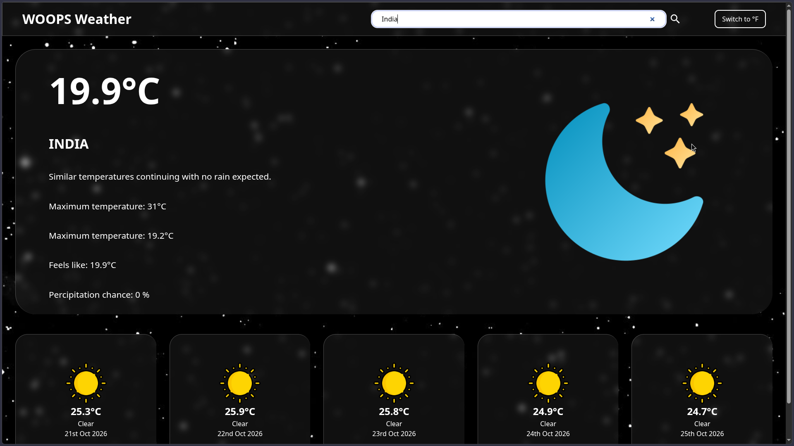

# Weather App

A weather app for the odin project

Weather app which utilises the free api provided by the Visual crossing. The app also stores the last searched query in webstorage and fetches it every reload.
Also has an error block which tells the user if they made a mistake in their query.

## Credits:

Credits to the owners of the respective icons on https://pictogrammers.com/ and https://www.flaticon.com/free-icons/weather

Credits to the owners of the background images on https://in.pinterest.com/

Credis to the weather data to https://www.visualcrossing.com/
